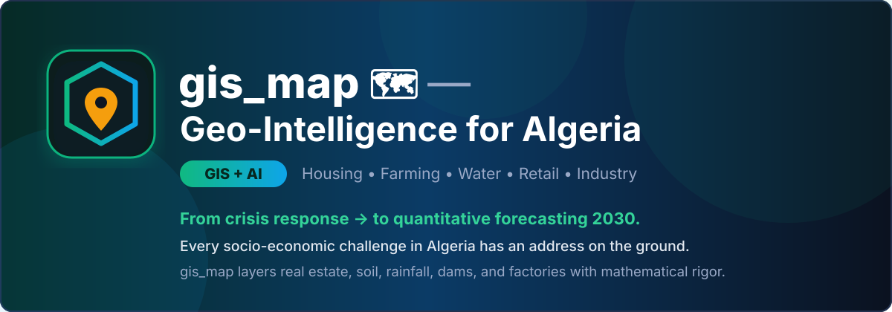

<p align="center">
  <a href="https://github.com/salim-stat-ai/gis_map_dz">
    
  </a>
</p>

<h1 align="center">GIS Map — Geo-Intelligence for Algeria</h1>
<p align="center">
  <strong>National Spatial Decision-Support & Quantitative Foresight Platform 2030</strong><br>
  <em>AI + Spatial Econometrics (GIS) + Quantitative Algorithmic Forecasting + Multi-Agent Intelligence</em>
</p>

<p align="center">
  <a href="https://github.com/salim-stat-ai/gis_map_dz"></a>
  <a href="https://gismap2.vercel.app/"></a>
  
  
  
  
</p>

---

<p align="center">
  <a href="https://github.com/salim-stat-ai/gis_map_dz">
    
  </a>
</p>

> **"From crisis response → to quantitative forecasting 2030.**  
> Every socio-economic challenge in Algeria has an address on the ground. `gis_map` layers real estate, soil, rainfall, dams, and factories with mathematical rigor."

---

## 1. Executive Summary & Vision

**GIS Map – Geo-Intelligence for Algeria** is an enterprise-grade sovereign decision-support platform engineered to transform raw geospatial data, multi-sector time-series, and environmental observations into auditable 2030 strategic forecasts.

$$\mathbf{\text{National Foresight 2030}} = \mathbf{\text{AI Agents}} + \mathbf{\text{Spatial Econometrics (GIS)}} + \mathbf{\text{Deterministic Forecasting Engine}} + \mathbf{\text{Multi-Criteria Governance}}$$

Unlike superficial conversational bots, all quantitative findings within `gis_map` originate from **rigorous mathematical and statistical computing engines** executed in real time across all **58 Algerian Wilayas** spanning **5 strategic national development pillars**:

1. **Housing & Urban Planning (السكن والعمران):** Land availability, $/m^2$ price trends, flood plain hazard zones, and safe urban expansion corridors.
2. **Agriculture & Food Security (الفلاحة والأمن الغذائي):** Soil quality indices, satellite NDVI vegetation health, annual rainfall, and cereal vulnerability.
3. **Water Resources & Desalination (الموارد المائية وتحلية المياه):** Dam fill capacities, deep aquifer boreholes, desalinated water pipeline integration, and chronic deficits ($m^3$).
4. **Commercial Supply & Regulated Markets (التجارة وضبط الأسواق):** Wholesale distribution depots, cold-chain storage coverage, and price volatility monitoring.
5. **Industry & Strategic Investment (الصناعة وترقية الاستثمار):** High-voltage electrical power grids, logistics corridors, national highway connectivity, and skilled industrial workforce availability.

---

## 2. Core Architectural Engines

### 2.1 Quantitative Forecasting Engine (12 Algorithmic Models)
Deterministic, auditable computational forecasting with out-of-sample backtesting:

* **Time Series & Exponential Smoothing**:
  * **ARIMA(p, d, q)**: Box-Jenkins autoregressive integrated moving average with automated AIC-minimizing order selection and drift estimation.
  * **SARIMA(p, d, q)×(P, D, Q)$_s$**: Multiplicative seasonal autoregression capturing annual agro-climatic and macroeconomic cycles.
  * **Holt's Linear Exponential Smoothing**: Double exponential filtering modeling level ($L_t$) and additive slope trend ($T_t$).
  * **ETS(A, A, N)**: State-space formulation providing exact mathematical variance decomposition.
* **Econometric Regressions**:
  * **Ordinary Least Squares (OLS) Linear Regression**: Full ANOVA decomposition, $t$-statistics, $F$-statistic, $R^2$, and Adjusted $R^2$.
  * **Multiple Linear Regression**: Multi-variable matrix solver $(X^T X)^{-1} X^T Y$ quantifying inter-indicator elasticity.
  * **Polynomial Degree-2 Curve**: Quadratic trajectory tracking acceleration, plateauing, and critical inflection points.
  * **Ridge Regression (Tikhonov $L_2$)**: Shrinkage estimator $\hat{\beta} = (X^T X + \lambda I)^{-1} X^T Y$ resolving multi-collinearity among infrastructure variables.
  * **Lasso Regression ($L_1$)**: Sparse feature selection via coordinate descent with soft-thresholding operator $\mathcal{S}(z, \lambda)$.
* **Machine Learning & Ensemble Regressors**:
  * **Random Forest Ensemble**: Bagged forest ($B=50$ bootstrapped trees) with randomized feature subsets at each split node.
  * **XGBoost / Gradient Boosted Trees**: Sequential pseudo-residual shrinkage with learning rate $\eta = 0.1$ and loss reduction controls.
* **Probabilistic Risk & Stress-Testing**:
  * **Monte Carlo Stochastic Simulation ($N = 1,500$ runs)**: Geometric Brownian motion with drift parameter $\mu$ and volatility $\sigma$, generating empirical 80% and 95% confidence intervals.
* **Model Tournament & Walk-Forward Validation**:
  * Rolling Out-Of-Sample backtesting evaluating RMSE, MAE, MAPE, AIC, and BIC to rank and pick the champion model automatically.

---

### 2.2 Advanced GIS Spatial Engine
Spatial statistics and spatial econometrics providing territorial intelligence:

* **Global Spatial Autocorrelation (Moran's I)**:
  $$I = \frac{n}{S_0} \frac{\sum_{i=1}^n \sum_{j=1}^n w_{ij}(x_i - \bar{x})(x_j - \bar{x})}{\sum_{i=1}^n (x_i - \bar{x})^2}$$
  Standardized $Z$-score testing identifying whether economic phenomena are clustered, dispersed, or random.
* **Hotspot Analysis (Getis-Ord $G_i^*$)**:
  Local spatial clustering identifying statistically significant hotspots (90%, 95%, 99% confidence) and coldspots for water stress, agricultural deficits, and price surges.
* **Spatial Econometric Regression (Spatial Lag / SAR)**:
  $$Y = \rho W Y + X \beta + \epsilon$$
  Estimating spatial spillover coefficients ($\rho$) to evaluate how neighboring wilayas influence local indicators.
* **Spatial Interpolation & Continuous Surface Modeling**:
  * **2D Kernel Density Estimation (KDE)**: Bivariate quartic kernels mapping continuous hazard zones.
  * **Ordinary Kriging**: Best Linear Unbiased Estimator (BLUE) with spherical semivariogram modeling:
    $$\gamma(h) = c_0 + c \left[ 1.5 \left(\frac{h}{a}\right) - 0.5 \left(\frac{h}{a}\right)^3 \right]$$
* **Analytic Hierarchy Process (AHP)**: Multi-criteria decision analysis prioritizing industrial and agricultural suitability with consistency ratio validation ($CR < 0.10$).
* **Basemap Switcher (Free / No Key Required)**:
  * OpenStreetMap Standard (OSM)
  * Esri High-Resolution Satellite Imagery
  * Esri Dark Canvas
  * OpenTopoMap Topographic Relief

---

### 2.3 Multi-Format Data Ingestion & Processing Pipeline
Seamless feeding of the live map and models from local files or remote data portals:

* **Supported Input Formats**:
  * Spreadsheets: `CSV`, `TSV`, `TXT`, `Excel (.xlsx, .xls)`.
  * Spatial Formats: `GeoJSON`, `KML`, zipped `Shapefiles (.zip with .shp + .dbf)`.
  * Relational Databases: `SQLite (.db, .sqlite, .sqlite3)`.
* **18 Standard Indicator Column Auto-Mapping**:
  Automatically recognizes column aliases and binds them to the national indicator schema:
  1. Wilaya name (`name`) | 2. Latitude (`lat`) | 3. Longitude (`lon`)
  4. Population (`pop`) | 5. Price/m² (`price`) | 6. Flood risk (`flood`)
  7. Soil quality (`soil`) | 8. Rainfall (`rain`) | 9. NDVI vegetation (`ndvi`)
  10. Dams (`dams`) | 11. Wells (`wells`) | 12. Water deficit (`waterDef`)
  13. Markets (`markets`) | 14. Retail coverage (`coverage`) | 15. Energy grid (`energy`)
  16. Road connectivity (`roads`) | 17. Labor force (`labor`) | 18. Industrial capacity (`industry`)
* **Built-in Global & National Data Sources**:
  * **GADM**: Official administrative polygon boundaries for Algeria.
  * **OpenStreetMap Overpass API**: Live extraction of dams, reservoirs, and healthcare facilities.
  * **World Bank REST API**: Algeria time-series indicators (population, macro trends).
  * **NASA POWER API**: Climatological rainfall and solar irradiance.
  * **ONS & ANRH**: Built-in sample datasets (`wilaya_indicators.csv`, `dams.geojson`).
* **CORS Proxy Route**: Native server proxy (`/api/proxy?url=...`) bypassing cross-origin restrictions.
* **Multi-Format Dataset Export**:
  Export live datasets and 2030 forecasted values to `CSV (UTF-8 BOM)`, `Excel (.xlsx)`, `GeoJSON`, `KML`, and `JSON`.

---

### 2.4 Seven Specialized AI Agents
Seven specialized personas running quantitative rules and localized heuristics:

1. **Muse Spark** — Lead Policy Synthesizer & Strategic Directives Author.
2. **Gemini Pro (Google)** — Deep Multimodal Analyst & Macroeconomic Trend Miner.
3. **ChatGPT (OpenAI)** — Scenario Simulation & Decision Tree Evaluator.
4. **Qwen (Alibaba)** — Industrial Supply Chain, Port Logistics & Highway Expert.
5. **DeepSeek (DeepSeek)** — Mathematical Auditor & Spatial Econometric Validator.
6. **Claude (Anthropic)** — Institutional Risk, Water Ethics & Sustainability Overseer.
7. **Grok (xAI)** — Real-time Emergency Radar, Inflation & Geopolitical Stress Tester.

---

### 2.5 12-Step Sovereign AI Council Chamber
Simulates an executive cabinet deliberation across 12 structured procedural milestones:

```
[01. Quorum Verification] ──► [02. Math Proof Audit] ──► [03. Spatial Spillover Analysis]
                                                                     │
[06. Tournament Review]   ◄── [05. Cross-Sector Risk] ◄── [04. Baseline vs Target Variance]
       │
[07. Divergence Flagging] ──► [08. Extreme Stress-Test] ──► [09. Budgetary Optimization]
                                                                     │
[12. Sovereign Roadmap]   ◄── [11. Consensus Vote]     ◄── [10. Executive Decision Points]
```

---

### 2.6 Multi-Hazard National Early Warning System
Automated continuous rule-based scanning detecting critical flashpoints:
* **Water Emergency**: Wilayas exhibiting severe deficits ($< -25\text{ m}^3$) and dam depletion below 20%.
* **Flash Flood Vulnerability**: Steep topography combined with saturated rainfall projections ($> 0.20$ risk).
* **Supply Chain Breakdown**: Commercial market coverage deficits exceeding 35%.
* **Price Shocks**: Anomalous real estate and agricultural price deviations exceeding $+2.5\sigma$.

---

### 2.7 Sovereign Decision Reporting Engine
* **A4 Formal Executive Print Layout**: High-density statistical styling optimized for physical printouts and ministerial submissions.
* **Three Report Modalities**: Combined 2030 Dossier, Legacy 7-Section Diagnostic, or 2030 Quantitative Foresight.
* **Interactive Standalone HTML Export**: Self-contained report file with embedded charts and CSS.
* **Standardized CSV Export**: Exporting full indicators and predictions.

---

## 3. Repository & Directory Structure

```
gis_map_dz/
├── assets/
│   ├── logo.svg                         # Official emblem with hexagon & location pin
│   └── banner.svg                       # Full-width 1200x420 hero banner with 2030 slogan
├── public/
│   ├── assets/                          # Static assets served by web app
│   └── samples/
│       ├── wilaya_indicators.csv        # 18-indicator verified national benchmark dataset
│       └── dams.geojson                 # Spatial points for major Algerian reservoirs
├── src/
│   ├── components/
│   │   ├── Header.tsx                   # Top navigation bar, language toggle (EN / AR)
│   │   ├── NavigationTabs.tsx           # 9 analytical module tabs with alert badges
│   │   ├── GisMapSection.tsx            # Leaflet map, 4 basemaps, radar & forecast charts
│   │   ├── QuantitativeCenter.tsx       # 12-model forecasting laboratory & tournament
│   │   ├── SpatialAnalysisLab.tsx       # Moran's I, Getis-Ord Gi*, SAR lag, Kriging, KDE
│   │   ├── ScenarioCenter.tsx           # Optimistic / Baseline / Pessimistic pathways to 2035
│   │   ├── AgentsCenter.tsx             # 7 AI Agent analysis with live OpenRouter toggle
│   │   ├── CouncilChamber.tsx           # 12-step AI Council consensus chamber
│   │   ├── EarlyWarningDashboard.tsx    # Multi-hazard national crisis radar
│   │   ├── Foresight2030Dashboard.tsx   # Strategic 2030 national foresight observatory
│   │   ├── DataImportStudio.tsx         # Multi-format data ingestion, mapping & export
│   │   └── ReportModal.tsx              # Executive A4 report generator & file exporter
│   ├── engines/
│   │   ├── quantitative.ts              # 12 algorithmic forecasting models
│   │   ├── gis.ts                       # Spatial statistics, SAR, Kriging, KDE, AHP
│   │   ├── dataRegistry.ts             # 58 Algerian wilayas historical dataset
│   │   ├── dataImportEngine.ts          # Parsers, auto-mapping aliases, exporters (CSV/XLSX/KML/GeoJSON)
│   │   ├── ingestion.ts                 # Audit logging and coordinate bounds sanitizer
│   │   ├── scenario.ts                  # Macroeconomic pathway generator
│   │   ├── evaluation.ts                # Out-of-sample backtesting & tournament metrics
│   │   ├── agents.ts                    # 7 AI agent personas and analytical workflows
│   │   ├── council.ts                   # 12-step consensus resolution engine
│   │   ├── earlyWarning.ts              # Multi-hazard threshold scanner
│   │   └── reporting.ts                 # Bilingual strategic report generator
│   ├── types/
│   │   └── index.ts                     # TypeScript interfaces and data contracts
│   ├── App.tsx                          # Main application orchestrator
│   ├── index.css                        # Tailwind CSS v4 + Leaflet styling
│   └── main.tsx                         # React entry point
├── server.ts                            # Full-stack Express server + Vite middlewares + /api/proxy
├── index.html                           # HTML shell with typography and SEO metadata
├── metadata.json                        # Applet metadata & server capabilities
├── package.json                         # Dependencies and build scripts
└── tsconfig.json                        # TypeScript compiler configuration
```

---

## 4. REST API Specification

| Endpoint | Method | Parameters | Description |
|---|---|---|---|
| `/api/proxy` | `GET` | `url` | Server-side CORS proxy for external geo-data portals (GADM, OSM, NASA, World Bank) |
| `/api/wilayas` | `GET` | — | Returns the complete 58-wilaya registry with historical time-series |
| `/api/models` | `GET` | — | Catalogs all 12 mathematical forecasting algorithms |
| `/api/data/sources` | `GET` | — | Lists national data registries (ONS, ANRH, ONM, DSA, ASAL) |
| `/api/forecast` | `POST` | `model, wilayaNum, metric, years, values` | Computes forecasts with 80% & 95% confidence intervals |
| `/api/evaluate` | `POST` | `wilayaNum, years, values` | Executes rolling backtesting tournament across all models |
| `/api/spatial/analyze` | `POST` | `indicator, ahpCriteria` | Computes Moran's I, Getis-Ord hotspots, and AHP suitability |
| `/api/scenarios/run` | `POST` | `wilayaNum, customDrivers` | Simulates Optimistic, Baseline, and Pessimistic pathways |
| `/api/early-warning` | `GET` | `year, lang` | Scans national multi-hazard thresholds across all wilayas |
| `/api/agents/analyze` | `POST` | `agentId, wilayaNum, targetYear, lang` | Queries specialized AI agent for tailored diagnosis |
| `/api/council/convene` | `POST` | `wilayaNum, targetYear, lang` | Convenes the 12-step AI Council and generates the consensus dossier |

---

## 5. Getting Started & Installation

### Prerequisites
* **Node.js** >= 18.0.0
* **npm** >= 9.0.0 (or **bun** / **yarn** / **pnpm**)

### Quick Start
```bash
# 1. Clone the repository
git clone https://github.com/salim-stat-ai/gis_map_dz.git
cd gis_map_dz

# 2. Install dependencies
npm install

# 3. Start the development server (runs full-stack Express + Vite on port 3000)
npm run dev
```

Open your browser at `http://localhost:3000`.

### Production Build & Deployment
```bash
# Compile and build the production client bundle
npm run build

# Start the production full-stack server
npm start
```

### Vercel Zero-Config Deployment
The repository is fully optimized for automated zero-config deployment on [Vercel](https://vercel.com/):
1. Connect your GitHub repository `https://github.com/salim-stat-ai/gis_map_dz`.
2. Framework preset: **Vite**.
3. Build command: `npm run build`.
4. Output directory: `dist`.

---

## 6. Official Data Source Attribution

* **ONS (Office National des Statistiques)**: National demographic census, consumer price index, and labor workforce statistics.
* **ANRH (Agence Nationale des Ressources Hydrauliques)**: National dam storage, groundwater extraction, and hydrologic stress metrics.
* **ONM (Office National de la Météorologie)**: Official meteorological stations and historical rainfall observations.
* **MADR / DSA (Ministère de l'Agriculture et du Développement Rural)**: Agricultural land zoning, crop yields, and agrarian infrastructure.
* **Copernicus / Sentinel-2 (ESA)**: High-resolution satellite remote sensing and NDVI vegetative density.
* **GADM**: Database of Global Administrative Areas (Algerian Wilaya boundaries).
* **OpenStreetMap (OSM)**: Open geodata for hydraulic infrastructure, reservoirs, and public amenities.

---

## 7. License & Credits

* **Author & Lead Architect**: Salim Slimani ([@salim-stat-ai](https://github.com/salim-stat-ai))
* **Repository**: [https://github.com/salim-stat-ai/gis_map_dz](https://github.com/salim-stat-ai/gis_map_dz)
* **Production Deployment**: [https://gismap2.vercel.app/](https://gismap2.vercel.app/)
* **License**: Open-Source Decision Support Software — Apache License 2.0.

*Developed for the Algerian National Foresight Initiative 2030.*
