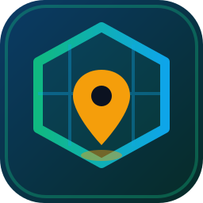
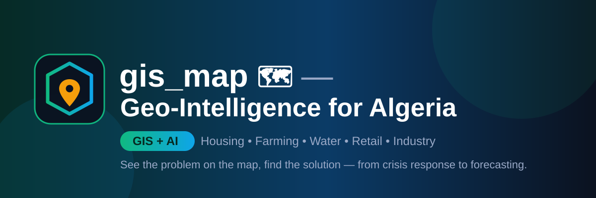

<p align="center">
  
</p>

# gis_map 🗺️ — Geo-Intelligence for Algeria



**See the problem on the map, find the solution.** A web app combining **GIS** and **AI** to diagnose and forecast Algeria's economic and social challenges — from crisis response to prediction.

## Sectors on one map
| Sector | Layers |
|---|---|
| 🏠 Real estate | Available land, price/m², roads, schools, water/power grids, flood & landslide risk |
| 🌾 Agriculture | Satellite NDVI, soil maps, rainfall — cereal vs orchard suitability + pre-harvest alerts |
| 💧 Water | Dams, wells, groundwater vs population, farm & industrial demand — next-summer thirst map |
| 🛒 Retail coverage | Markets, depots, outlets over population — gaps and clusters, where to open next |
| 🏭 Industry | Water + energy + road/port + labor — site scoring that explains empty zones |

## Where AI comes in
The map shows reality; AI reads millions of data points in minutes, flags anomalies and forecasts: water demand, urban sprawl, drought-hit crops.

## Run
Open `index.html` directly, or:
```bash
cd gis_map
python3 -m http.server 8000
# http://localhost:8000
```

## 🧠 AI Agent Team
| Agent | Role |
|---|---|
| ⚡ Muse Spark 1.3 | Map Analyst — WHERE and WHY on the map |
| ✨ Gemini 3 Flash | Crisis Manager — 72-hour triage |
| 🤖 ChatGPT | Foresight Strategist — scenarios to 2030 |
| 🌊 Qwen Max | Water & Agriculture Expert |
| 🧠 DeepSeek R1 | Deep Reasoner — root causes with numbers |
| 📜 Claude Sonnet | Risk & Policy Advisor |
| 📡 Grok 2 | Anomaly Watch |

Press **🏛️ Convene council** for a 7-agent consensus. Agents run offline out of the box; add an OpenRouter API key in the app for live model calls (key never leaves your browser).

## 📥 Data Import
All **58 wilayas** ship in the app (pick any from the header dropdown). Bring your own data:
- **Files:** CSV, Excel (.xlsx), TXT/TSV, JSON, GeoJSON, KML, zipped Shapefiles (.zip with .shp + .dbf), SQLite (.db)
- **URLs:** paste any direct data link (open-data portals, GitHub raw…); auto CORS-proxy fallback included. After fetch: **⬇ Raw file** downloads the source bytes, **Merge** pushes rows into the live analysis (map, forecasts, dashboard, agents, exports) and auto-runs the Agent Council on the first imported wilaya
- **Ready sources dropdown:** GADM Algeria provinces, OSM dams & hospitals via Overpass, world countries, plus built-in offline samples — one click to fetch
- OSM/Overpass JSON auto-flattens; polygons fall back to bbox center; accent-insensitive name matching (Sétif = Setif, Alger = Algiers)
- **Flow:** load → columns auto-map to the 18 indicators → check the preview → **Merge into map** (updates existing wilayas, adds new places as map points)
- **Export:** one click to **CSV / Excel / GeoJSON / KML** — full dataset *plus* AI forecasts, ready for QGIS/ArcGIS
- Grab the **📄 CSV template** in the app to see the expected columns.

## 📄 Detailed Reports (NEW)
Press **📄 Report / تقرير** in the header for print-ready A4 reports (AR/FR/EN, horizon 2027–2035):
- **Scopes:** single wilaya · up-to-6 comparison · 7 thematic cases (water, drought, urban, retail, flood, industry, AI anomalies) · national synthesis
- **Content:** cover + report ID · executive summary · 6 KPIs · full 18-indicator sheet per wilaya (value + national average + rank + status) · 5-sector deep dives · year-by-year forecasts 2026–2035 · risk matrix · action plan (priority + owner + horizon + impact) · methodology + signature block
- **Export:** 🖨️ Print/PDF · ⬇ standalone HTML · ⬇ detailed CSV — sample issues in `reports/`

## Files
- `index.html` — UI (English)
- `data.js` — 58 wilayas demo data (extend with GeoJSON + Sentinel-2 / ONM / ANRH / ONS)
- `app.js` — GIS + AI engine (water forecast, drought risk, urban growth, anomaly detection)
- `agents.js` — agent roster, offline expert engine, council voting, OpenRouter live calls
- `import.js` — file/database import (CSV/Excel/GeoJSON/KML/SHP/SQLite) with column mapping
- `report.js` — detailed report generator (wilayas & cases, AR/FR/EN, print + HTML + CSV)
- `reports/` — sample issued reports (Setif detailed · 6-wilaya comparison · national FR)
- `style.css` — visual identity (navy + emerald + gold)

## Roadmap
- [ ] 58 wilayas with real GeoJSON boundaries
- [ ] Live feeds + satellite tiles
- [ ] Trained ML model (Python backend)

---
© 2026 Copyright salim-slimani. All rights reserved.
